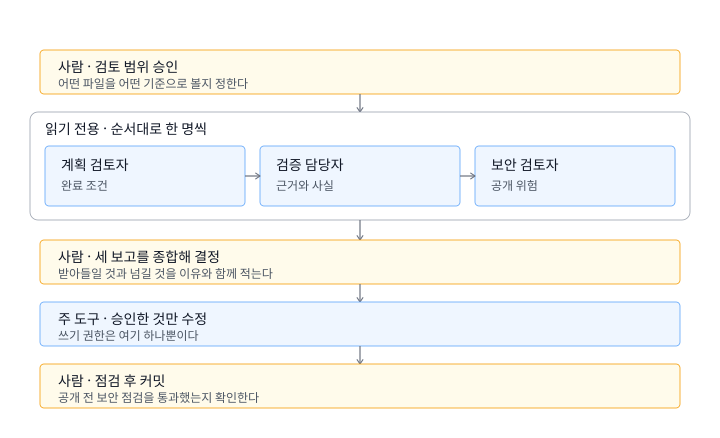

# 멀티에이전트 기초 — 역할을 나눠 검토받기

> **무엇을** 같은 결과물을 서로 다른 기준으로 읽는 검토자 역할을 여러 개 두고, 사람이 그 보고를 종합해 결정합니다.
> **왜** 한 대화에서 만들고 검토까지 하면, 만든 쪽의 관점에 갇혀 문제가 안 보입니다.
> **나에게 무슨 의미** 혼자 작업하면서도 여러 사람에게 검토받는 효과를 얻습니다.

이 문서는 [4주차](05-session-4.md) 실습 5의 상세 안내입니다. 4주차 수업 안에서는 요약판을 진행하고, 더 해 보고 싶을 때 이 문서를 사용합니다.

## 2분 워밍업 — 위임이 어떻게 생겼는지 먼저 보기

설명을 읽기 전에 한 번 돌려 보는 편이 빠릅니다. **내 프로젝트와 상관없는 주제**로 합니다.

```text
자. 너는 대장 에이전트야. 이제 네가 할 일은 내가 하는 말을 잘 듣고
다른 에이전트에게 일을 시키는 거야.
할 일을 말해 줄 테니 최대 3개의 에이전트에게 일을 분배해서 진행시켜.
자, 할 일을 나열하겠다.
짜파게티를 주제로 하는 시를 짓고, 이것을 다른 에이전트가 검토하게 해라.
그리고 목살 굽는 레시피를 만들고 이를 다른 에이전트가 검토하게 하라.
```

두 가지를 한 번에 보게 됩니다.

- **만드는 역할과 검토하는 역할을 나누면 검토가 실제로 달라진다** — 이 과정 멀티에이전트의 핵심입니다.
- **에이전트에게 지휘까지 맡기면 중간이 안 보인다** — 결과만 오고, 무엇을 왜 그렇게 판단했는지는 남지 않습니다.

두 번째가 아래 모든 규칙의 이유입니다. 시와 레시피는 틀려도 손해가 없으니 이렇게 해도 됩니다. **내 결과물에서는 그 중간 판단이 곧 품질**이라서, 지휘를 사람이 가져옵니다.

이 워밍업은 여기서 끝냅니다. 결과물을 저장하거나 프로젝트에 넣지 않습니다.

## 먼저 — 멀티에이전트가 아닌 것

"멀티에이전트"를 여러 에이전트가 **동시에 파일을 고치는 것**으로 시작하지 않습니다. 초보 단계에서 그렇게 하면 누가 무엇을 바꿨는지 알 수 없고, 충돌이 나면 복구가 어렵습니다.

이 과정에서 멀티에이전트는 이렇게 시작합니다.

- **읽기만** 하는 검토자 여러 명 + **쓰기는 하나만**
- **순서대로** 한 명씩 (동시에 아님)
- **종합과 결정은 사람**

## 왜 성격이 아니라 기준인가

역할을 만들 때 "냉철한 보안 전문가입니다" 같은 **성격 설정은 결과를 거의 바꾸지 않습니다.** 검토 품질을 올리는 것은 성격이 아니라 다음 세 가지입니다.

1. **무엇을 볼지** (판정 기준)
2. **무엇을 하지 말지** (파일 수정 금지, 추측 금지)
3. **어떤 형식으로 보고할지** (그래야 사람이 빨리 읽습니다)

그래서 이 과정에서는 역할별 성격 파일(`role.md`, `soul.md` 같은)을 만들지 않고, **짧은 기준 파일 하나**([검토 역할 템플릿](../templates/review-roles.md))를 씁니다. 이미 배운 [작업 지시서](../templates/task-brief.md)를 검토용으로 재사용하는 것과 같습니다.

## 세 가지 기본 역할

| 역할 | 무엇을 보나 | 대표 질문 |
|---|---|---|
| **계획 검토자** | 목표와 범위 | 완료 조건을 정말 충족했나? 빠진 조건은? |
| **검증 담당자** | 근거와 사실 | 이 주장의 출처가 실제로 있나? 예시 입력이 정말 통하나? |
| **보안 검토자** | 공개 위험 | 개인정보·비밀정보·타인 자료가 섞이지 않았나? |

세 역할은 **같은 결과물을 서로 다른 기준으로** 읽습니다. 역할을 더 늘리지 않습니다. 셋이면 충분합니다.

## 사람이 오케스트레이터입니다

첫 경험에서는 **사람이 지휘자**입니다. 에이전트가 다른 에이전트를 알아서 호출하게 하면 편해 보이지만, 무엇이 왜 잘못됐는지 볼 수 없습니다.



노란 칸이 사람이 결정하는 자리이고, 파란 칸은 도구가 하는 일입니다. 그중 파일을 고칠 수 있는 것은 "주 도구" 칸 하나뿐입니다.

**순차로 하는 이유:** 앞 역할의 발견을 다음 역할에게 넘겨줄 수 있고, 하나씩 읽으니 사람이 따라갈 수 있습니다.

## 도구에서 어떻게 하나

### 기본 방법 — 새 대화창 3개 (권장)

특별한 설정이 필요 없고 Codex·Claude Code 양쪽에서 똑같이 됩니다.

1. 주 작업 대화는 그대로 두고, **새 대화(세션·스레드)를 하나 엽니다.**
2. [검토 역할 템플릿](../templates/review-roles.md)에서 역할 하나의 프롬프트를 붙여 넣습니다.
3. 검토할 파일 경로를 알려 줍니다.
4. 보고서를 받아 `logs/`에 저장합니다.
5. 대화를 닫고, 다음 역할로 **새 대화를 다시** 엽니다.

**새 대화로 여는 것이 중요합니다.** 같은 대화에서 역할만 바꾸면, 앞서 만든 내용과 앞 역할의 결론에 이미 물들어 있어서 새로운 문제를 찾지 못합니다.

### 읽기 전용으로 두는 방법

검토자는 **파일을 고치지 않아야** 합니다. 두 겹으로 막습니다.

- **프롬프트로**: "파일을 수정하지 마세요. 읽고 보고서만 주세요."
- **도구 기능으로**: 사용하는 도구에 계획 모드나 읽기 전용/승인 필요 설정이 있으면 켭니다. 파일 수정 요청이 오면 승인하지 않습니다.

권한 관련 설정 이름은 도구와 버전마다 다르므로, 각 도구의 공식 문서에서 확인합니다([도구 선택 안내](01a-tool-choice.md)의 링크 참고).

### 심화 (선택) — 도구의 서브에이전트 기능

일부 도구는 역할을 파일로 정의해 두고 재사용하는 기능(서브에이전트/커스텀 에이전트)을 제공합니다. 같은 역할을 매주 반복해서 쓰게 되면 그때 옮기면 됩니다.

지금 이 기능부터 시작하지 않는 이유: 설정이 도구에 묶이고, 잘못 작동할 때 원인을 찾기 어렵습니다. **먼저 대화창 3개로 흐름을 이해한 뒤**, 손에 익은 역할만 옮기는 순서를 권합니다.

## 사람이 개입할 4개 지점

에이전트에게 다 맡기지 않고, 아래 네 곳에서 **반드시 사람이 결정**합니다.

| 지점 | 언제 | 사람이 하는 일 |
|---|---|---|
| **1. 범위 승인** | 검토 시작 전 | 어떤 파일을 검토할지, 무엇을 기준으로 볼지 확정 |
| **2. 보고 충돌** | 역할들의 말이 엇갈릴 때 | 어느 지적을 받아들일지 판단 (양쪽 다 맞을 수도 있음) |
| **3. 수정 직전** | 주 도구가 파일을 고치기 전 | 무엇을 고칠지 목록으로 승인. 승인 안 한 것은 고치지 않음 |
| **4. 공개 직전** | 커밋·푸시·공유 전 | [보안 점검](07-security-and-sharing.md) 통과 확인 |

### 에이전트가 나에게 물어보게 하기

각 역할 프롬프트에 이 문장을 넣습니다.

```text
확실하지 않은 것은 추측하지 말고, 저에게 질문으로 남겨 주세요.
판단이 갈리는 부분은 선택지와 각각의 장단점만 제시하고, 결정은 제가 하겠습니다.
```

[2주차의 양방향 상호작용](03-session-2.md)과 같은 방식입니다. 에이전트가 질문·검토·제안까지 하고, **결정은 사람이** 합니다.

### 왜 하필 이 4곳인가

- **1번**: 범위를 안 정하면 검토가 산만해지고 시간이 무한정 늘어납니다.
- **2번**: 충돌은 에이전트가 해결할 수 없습니다. 무엇이 더 중요한지는 프로젝트 목표를 아는 사람만 압니다.
- **3번**: 되돌리기 가장 어려운 순간이 파일 수정입니다.
- **4번**: 공개는 취소가 안 됩니다. 한 번 나간 정보는 되돌릴 수 없습니다.

## 보고서를 어디에 남기나

검토 보고서도 채팅에 두지 않고 파일로 남깁니다([1주차의 챗 → 파일 흐름](02-session-1.md)).

```text
logs/
  review-plan-2026-07-25.md
  review-evidence-2026-07-25.md
  review-security-2026-07-25.md
  review-decision-2026-07-25.md   ← 사람이 종합한 결정
```

`review-decision-...md`에는 **무엇을 받아들이고 무엇을 넘겼는지, 그 이유**를 적습니다. 나중에 "왜 이건 안 고쳤지?"에 답할 수 있습니다.

## 흔한 실패

| 실패 | 이유 | 대응 |
|---|---|---|
| 워밍업처럼 "대장 에이전트"에게 실제 작업까지 맡김 | 지휘와 종합까지 위임함 | 역할마다 새 대화를 열고 순서·종합은 사람이 |
| 검토자가 파일을 고쳐 버림 | 읽기 전용 지시가 없었음 | 프롬프트에 수정 금지 + 승인 거부 |
| 세 역할이 똑같은 말만 함 | 같은 대화에서 역할만 바꿨음 | 역할마다 새 대화 |
| 지적이 너무 많아 손을 못 댐 | 우선순위가 없음 | "가장 중요한 3개만" 요청 |
| 근거 없는 지적 | 추측을 허용했음 | "근거가 되는 파일·위치를 함께 표시" 요구 |
| 결국 아무것도 안 고침 | 결정 단계가 없었음 | `review-decision` 파일에 결정을 적고 커밋 |

## 확인 체크리스트

- [ ] 검토자 역할이 파일을 수정하지 않았다.
- [ ] 역할마다 새 대화에서 진행했다.
- [ ] 세 보고서가 각각 다른 관점을 담고 있다.
- [ ] 보고가 엇갈린 지점을 내가 판단했다.
- [ ] 무엇을 고치고 무엇을 넘길지 결정을 기록했다.
- [ ] 수정 전에 내가 승인했다.
- [ ] 공개 전 보안 점검을 통과했다.

## 다음 단계

여기서 한 일(역할 분리, 순차 실행, 사람의 결정 지점)은 멀티에이전트 설계의 기본형입니다. 더 나아가는 방향은 [다음 단계](09-next-steps.md)를 참고합니다. [수료 후 30일 운영](08-after-course.md)의 확장 기준을 먼저 통과하는 것을 권합니다.
